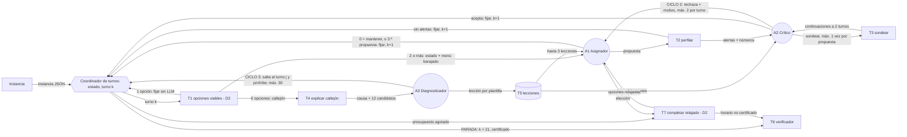

# Asignación de Turnos Médicos con un Sistema de Agentes (LLM open-weight)

**Generative Artificial Intelligence (580694) · Universidad de Concepción · Grupo 11**
**Deliverable 3**: la solución de Deliverable 2 reconstruida como un sistema de tres agentes, sobre la misma tarea, la misma falla y el mismo criterio de corrección.

- 🎥 **Video (≤3 min):** [VIDEO_LINK](VIDEO_LINK)
- 📄 **Documento técnico (1 página, LaTeX):** [`deliverable3/Deliverable 3 Grupo 11.pdf`](deliverable3/Deliverable%203%20Grupo%2011.pdf) · fuente [`deliverable3/deliverable3.tex`](deliverable3/deliverable3.tex) (se compila con `pdflatex -jobname="Deliverable 3 Grupo 11" deliverable3.tex` dentro de `deliverable3/`)
- 🧩 **Prompts de los agentes (versionados, fuera del código):** [`prompts/`](prompts/)
- 📁 Entregas anteriores: [`deliverable1/`](deliverable1/) · [`deliverable2/`](deliverable2/)

---

## 1. Resumen

Mismas 90 instancias y mismo verificador para todas las filas. Correcto = 0 violaciones.

| | Línea base (prompt directo, D1) | Solución D2 | **Sistema de agentes (D3)** |
|---|---|---|---|
| Principal (30, escala de D1) | 0/30 | 30/30 | **30/30** |
| Estrés (30) | 0/30 | 28/30 | **30/30** |
| Difícil (30, nuevo) | 0/30 | 22/30 | **30/30** |
| **Total** | **0/90** | **80/90** | **90/90** |
| Violaciones por horario (media) | 25.1 | 0.28 | 0 |
| Horarios resueltos sin ningún retroceso o salto | – | 42/90 | 78/90 |
| Pasadas del modelo por horario | 1 | 26 | 77 |
| Segundos por horario (RTX 5060) | 14 | 14 | 9 |

- **La técnica que más aporta es el Diagnosticador** (ReAct sobre la explicación del callejón). Si se lo quita y se vuelve al retroceso cronológico de D2, el sistema baja a **82/90**.
- **Le siguen los ejemplos (few-shot) y el Crítico.** Sin ejemplos el sistema queda en 87/90 y usa 44 % más pasadas. Sin el Crítico queda en 89/90, pero necesita casi 4 veces más saltos y deshace 12 decisiones por horario en vez de 3. La memoria (Reflexion) y el ensamble no cambian el resultado.
- **Lo que logra el andamiaje por sí solo:** los controles sin LLM ponen esto en contexto. Los mismos agentes eligiendo **al azar** también llegan a 90/90, con más saltos. D2 eligiendo al azar con 10 veces más presupuesto (300 retrocesos) llega a 85/90 de media, y los mismos agentes con reglas fijas, a 74/90.
- **Dónde aporta el modelo:** la evaluación por decisión con CP-SAT (§7) muestra que el Diagnosticador elige saltos útiles más que el azar. El Asignador solo, en cambio, no es mejor que el azar: la mejora viene de dividir el trabajo y de las herramientas tanto como del modelo.
- **Por qué D3 tarda menos con más pasadas:** cada llamada de D1 y D2 *genera* texto (`generate()`). D1 escribe el horario entero en JSON (~350 tokens) y D2 escribe una pareja de médicos por turno (unos 10 tokens), procesando cada vez el prompt completo. Cada pasada de D3 es una sola pasada hacia adelante (`score()`) que lee la probabilidad de etiquetas de 1 token y reutiliza en caché el prompt de sistema. Por eso el tiempo de D3 crece casi en proporción a las pasadas (sin ensamble: 48 pasadas, 5 s). Los segundos son el tiempo real medio por horario, sin la carga del modelo.

Modelo de los tres agentes: **meta-llama/Llama-3.2-3B-Instruct** (3.21B parámetros, revisión `0cb88a4f764b7a12671c53f0838cd831a0843b95`). Es el mismo de D2: 4-bit NF4, decodificación greedy, RTX 5060 8 GB.

## 2. Cómo reproducir lo que muestra el video

### 2.1 Instalación (Windows o Linux, GPU NVIDIA)
```bash
pip install torch==2.13.0 --index-url https://download.pytorch.org/whl/cu130
pip install -r requirements.txt
```
Llama-3.2 tiene licencia de Meta, así que hay que hacer esto una sola vez:
1. Aceptar la licencia en [huggingface.co/meta-llama/Llama-3.2-3B-Instruct](https://huggingface.co/meta-llama/Llama-3.2-3B-Instruct).
2. Crear un token de lectura.
3. Ejecutar `hf auth login`.

La primera ejecución del paso 2 descarga el modelo (~6 GB). También se puede descargar antes con `hf download meta-llama/Llama-3.2-3B-Instruct --revision 0cb88a4f764b7a12671c53f0838cd831a0843b95`. Sin GPU local, se puede usar Colab T4: [`notebooks/D3_Demo_Colab.ipynb`](notebooks/D3_Demo_Colab.ipynb).

### 2.2 Los 2 pasos del video
Están en `video/` como archivos que se ejecutan sin argumentos: `pasoN_*.py` (botón ▶ del IDE) o `N_*.bat` (doble clic). Cada uno corre un comando:

| Paso | Comando | Qué muestra |
|---|---|---|
| 1. Cómo se evalúa | `python src/protocol.py` | entradas (90 instancias), juez, criterio, métricas y la evaluación por decisión |
| 2. Agentes en vivo | `python src/demo_agents.py --set hard --instance hard_29` | la instancia `hard_29`, donde la solución de D2 falla (agota sus 30 retrocesos y queda con 1 violación) y el sistema de agentes llega a un horario válido; actúan los tres agentes, con 2 saltos del Diagnosticador. Muestra los mensajes entre los agentes a medida que ocurren (propuestas, alertas, rechazos, sondeos, callejones, saltos y lecciones), la grilla final, el verificador y la comparación con D2 en la misma instancia |

La tabla de resultados (línea base, D2, agentes, cada ablación y los controles en las mismas 90 instancias) no aparece en el video, pero se reproduce con `python src/report.py` (ver §7). El análisis general de fallas y el caso de falla tampoco aparecen, y se reproducen con `python src/report.py --fallas` (ver §8); la traza del caso de falla está en `results/traces/hard/llama-3.2-3b/agents_sin_diagnosticador/hard_22.jsonl`.

La traza completa de la demo queda en `results/demo/<instancia>_<fecha>.jsonl`. La de la corrida que aparece en el video es `results/demo/hard_29_<fecha del video>.jsonl`; las trazas de todas las instancias evaluadas están en `results/traces/`. Para otra instancia: `python src/demo_agents.py --random` (una al azar del conjunto difícil) o `--set stress --instance stress_04`.

**Presentación HTML del video.** `python video/servidor_video.py` (o `video/0_presentacion.bat`) abre `video/Deliverable 3 Representacion Video.html` en el navegador: las diapositivas de D3 (agentes y flujo) y una diapositiva por paso con un botón ▶ (o la tecla `R`) que ejecuta el `pasoN_*.py` y muestra su salida. En el paso 2, cada mensaje entre agentes mueve el diagrama de flujo, llena la semana y los contadores de los tres ciclos; con clic en un mensaje se ve el prompt exacto que recibió el agente, y la diapositiva siguiente muestra el horario final, el verificador y la comparación con D1 y D2.

### 2.3 Regenerar los resultados
```bash
# sistema de agentes y ablaciones (≈1.5 h en la RTX 5060 para las 90 instancias)
python src/evaluate.py --set main   --strategies agents,agents_sin_diagnosticador,agents_sin_critico,agents_sin_memoria,agents_sin_fewshot,agents_sin_ensamble
python src/evaluate.py --set stress --strategies agents,agents_sin_diagnosticador,agents_sin_critico,agents_sin_memoria,agents_sin_fewshot,agents_sin_ensamble
python src/evaluate.py --set hard   --strategies agents,agents_sin_diagnosticador,agents_sin_critico,agents_sin_memoria,agents_sin_fewshot,agents_sin_ensamble
# controles sin LLM (CPU, minutos): en cada conjunto (main, stress, hard) y con --seed 0 a 4
python src/evaluate.py --set hard --strategies agents_random,random,random_b300 --seed 0
python src/evaluate.py --set hard --strategies agents_rules
# D2 y línea base en el conjunto difícil (los de principal y estrés vienen de D2)
python src/evaluate.py --set hard --strategies direct,stepwise
# evaluación por decisión, análisis de fallas y pruebas de continuidad
python src/decision_eval.py --runs "*/llama-3.2-3b/agents,*/llama-3.2-3b/agents_sin_diagnosticador,*/llama-3.2-3b/agents_sin_critico,*/llama-3.2-3b/agents_sin_memoria,*/llama-3.2-3b/agents_sin_fewshot,*/llama-3.2-3b/agents_sin_ensamble,*/no_llm/agents_random,*/no_llm/agents_rules"
# (o una configuración por proceso con --out results/decision_parts/<config>.json y después --merge de los JSON)
python src/failure_analysis.py
python src/test_continuity.py
```
`evaluate.py` se salta las instancias que ya tienen resultado. Para volver a ejecutarlas hay que mover o borrar la carpeta correspondiente de `results/`. Cada resultado queda en `results/<conjunto>/<modelo>/<estrategia>/<instancia>.json`, y su traza en `results/traces/<conjunto>/<modelo>/<estrategia>/<instancia>.jsonl`. En las trazas ya guardadas (y en las de `results/demo/`), el coordinador de turnos aparece con su nombre anterior, `Orquestador`.

## 3. Continuidad con Deliverable 1 y 2, y desviaciones declaradas

**Igual que en D1 y D2:**
- la tarea: horario semanal de 10 médicos en 21 turnos, con salida JSON;
- las entradas: el conjunto principal, donde `inst_00` es el escenario de D1, y el de estrés;
- el juez y el criterio: `src/verifier.py`, donde correcto = 0 violaciones de HC1–HC6;
- el modelo: Llama-3.2-3B, el mismo en los tres agentes.

**La misma falla.** D1 diagnosticó la *decisión voraz*: se gastan los especialistas al principio de la semana y la semana se rompe al final (F1). D2 mostró que esa falla reaparece *dentro* de la elección. El análisis general de fallas (§8) lo cuantifica: la decisión culpable queda de 2 a 12 turnos antes del callejón, el chequeo hacia adelante la deja pasar y el retroceso cronológico no llega a ella. D3 ataca justamente eso:
- un **Crítico** revisa la propuesta antes de fijarla, con números que el chequeo de D2 no mira;
- un **Diagnosticador** decide a qué decisión pasada volver.

**Construido sobre D2:**
- La herramienta T1 es el estado, el filtro legal y el chequeo hacia adelante de D2 (`src/stepwise_solver.py`, sin cambios).
- T7 es el completado relajado de D2.
- Con la elección al azar de D2, sin Crítico y con retroceso cronológico, el coordinador de turnos reproduce idénticos los 90 horarios y retrocesos de la política al azar de D2 (`python src/test_continuity.py`).

**Desviaciones declaradas:**
1. **Conjunto difícil** (`data/instances_hard/`, 30 instancias, semillas 9000+). El principal está saturado: D2 ya hace 30/30. El conjunto se definió con criterios estructurales: capacidad total = demanda + 0..2, Urgencia = cuota + 0..2 y 1–2 bloqueos extra. Cada instancia está certificada factible y ninguna se eligió según el resultado de un método. La línea base y D2 se corrieron en él igual que en los otros.
2. **Decisiones de 1 token.** Cada decisión de un agente es una etiqueta de 1 token elegida por log-probabilidad (`LLM.score`), que equivale a la decodificación restringida greedy de D2 cuando la respuesta mide 1 token. Para ahorrar prefill se reutiliza el KV del prompt de sistema. El cálculo no es idéntico bit a bit: en una prueba, 1 de 12 elecciones cambió por redondeo 4-bit. Se usa igual en todas las filas de agentes.
3. **Presupuesto.** Son 30 saltos, el mismo número que los 30 retrocesos de D2, pero un salto puede deshacer hasta 12 decisiones. Por eso se reportan las decisiones deshechas y se agrega el control "D2 al azar con 300 retrocesos". No hay tope de pasadas del modelo: el costo se reporta, pero no corta corridas.
4. **Turnos con una sola opción.** Si un turno tiene una sola opción viable, se fija sin llamar al modelo; el trie la forzaría igual.
5. **Ajuste de prompts.** Los prompts se ajustaron solo con un conjunto de calibración de 20 instancias (`data/instances_calib/`) que no entra en la evaluación. Las 5 versiones y sus pilotos están en [`prompts/README.md`](prompts/README.md) y `results/calib/`.
6. **Correcciones antes de la evaluación final.** Una revisión adversarial del código encontró defectos en las herramientas y en la medición:
   - General contaba como especialidad escasa en 24 de las 90 instancias;
   - T4 culpaba a médicos bloqueados;
   - las lecciones afirmaban prohibiciones que no se aplicaban;
   - un tope de pasadas castigaba solo a las filas con LLM;
   - la ablación sin Diagnosticador apagaba también la memoria;
   - la línea base al azar del Diagnosticador contaba dos veces el turno anterior.

   Se corrigieron todos y **todas las cifras de este README salen del código corregido**; las corridas anteriores se descartaron.

## 4. El sistema de agentes

Tres agentes, el mismo modelo, cada uno con su prompt en [`prompts/`](prompts/). El coordinador de turnos (`src/coordinator.py`) es código, no un agente: lleva el estado y enruta el trabajo según lo que decide cada agente. Cada decisión es una etiqueta de un menú numerado, con salida restringida a 1 token.

| Agente | Rol | Recibe | Decide | Herramientas | Para o traspasa |
|---|---|---|---|---|---|
| **A1 Asignador** | elegir quién cubre el turno *k* | la tabla de estado de D2, el menú numerado de opciones viables (barajado, con los especialistas sobre la cuota de cada una), lecciones y, tras un rechazo, el motivo | número de opción; tras un rechazo, otra opción o `0` = mantener la suya | T1 (menú), T5 (lee) | su propuesta va a T2. Sin alertas se fija y se pasa a *k*+1; con alertas decide el Crítico |
| **A2 Crítico** | revisar UNA propuesta antes de fijarla | la propuesta y la mejor alternativa (la que deja más opciones al turno siguiente) con los números de T2: especialistas sobre la cuota, opciones viables en el turno siguiente, turnos futuros sin margen y, si sondeó, las continuaciones a 2 turnos | `1` aceptar · `2` rechazar · `3` sondear | T2, T3, T5 (lee) | acepta: se fija. Rechaza: vuelve a A1 sin esa opción (máx. 2 por turno; la tercera se fija). Sondea: llama a T3 y vuelve a decidir |
| **A3 Diagnosticador** | decidir qué decisión pasada rehacer tras un callejón | de T4: qué requisito futuro ya no se cubre, qué médicos podrían cubrirlo y por qué no pueden (HC1/HC2/HC5/HC6), y las últimas 12 decisiones con los médicos del conflicto que involucran | número de la decisión que se rehace | T4, T5 (escribe) | deshace los turnos *j*..*k*, prohíbe en *j* la opción anterior y al médico del conflicto, y escribe una lección. Tope: 30 saltos; después se completa en modo relajado (no certificado) |

**Herramientas** (`src/tools.py`). Todas informan: ninguna busca una solución ni filtra más que D2.
- **T1** `opciones_viables` (de D2): filtro legal + combinaciones con dotación y cuota + chequeo hacia adelante, menos lo prohibido.
- **T2** `perfilar`: rasgos de la propuesta y de la mejor alternativa, y alertas R1 (más especialistas sobre la cuota), R2 (deja muchas menos opciones al turno siguiente) y R3 (más turnos futuros sin margen).
- **T3** `sondear`: continuaciones viables a 2 turnos.
- **T4** `explicar_callejon`: causa del callejón y 12 decisiones candidatas en orden cronológico, sin ranking.
- **T5** `lecciones`: memoria verbal escrita con plantilla.
- **T6**: el verificador.
- **T7** `completar_relajado` (de D2).

**Por qué se divide así.** Cada rol es algo que la tarea requiere y que otro agente no cubre:
- **El Asignador mira a lo ancho:** necesita el menú completo, con poco dato por opción.
- **El Crítico mira a fondo:** una sola propuesta, con números de herramientas. Poner esos números para las 2–30 opciones del menú (mediana 5) en un mismo prompt de 3B lo degrada, y para un modelo chico verificar es más fácil que generar. La evaluación por decisión (§7) lo confirma: el Asignador solo elige como el azar, y los rechazos del Crítico interceptan la mayoría de las propuestas fatales que revisa.
- **El Diagnosticador es el único que mira hacia atrás.** La culpable está varios turnos atrás, y el Asignador y el Crítico solo ven el turno actual. Sus acciones son turnos pasados, no médicos.


El CICLO 1 es el avance turno a turno (21 turnos).

## 5. Técnicas de prompting de cada agente

Las técnicas se clasifican según la taxonomía de *The Prompt Report* (Schulhoff et al., 2024). Cada una es una sección del prompt o un paso del agente, y se quita **una a la vez** sobre las mismas 90 instancias (`agents_sin_*`). ReAct y CRITIC/Self-Refine son lo que hacen el Diagnosticador y el Crítico, así que para quitarlas se quita el agente que las implementa. En [`prompts/README.md`](prompts/README.md) está qué sección corresponde a cada técnica.

| Técnica (categoría) | Agente | Falla diagnosticada que ataca | Sin ella: correctos /90 · resueltos sin saltar · saltos · pasadas por horario |
|---|---|---|---|
| **Sistema completo** | | | **90** · 78 · 0.3 · 77 |
| ReAct sobre observaciones de herramientas (agentes); se quita el agente A3 completo y se vuelve al retroceso de D2 | A3 | F1 de D1, tal como reaparece en D2: la culpable está 2–12 turnos atrás y el retroceso cronológico no llega | **82 (−8)** · 78 · 2.9 · 66 |
| Few-shot (in-context learning) | todos | elegir mal la opción o el salto con poca información | **87 (−3)** · 67 · 1.8 · 112 |
| CRITIC + Self-Refine (autocrítica con herramientas); se quita el agente A2, porque las dos técnicas van juntas en él | A2 → A1 | el chequeo de D2 deja pasar opciones sin solución (solo el 48 % la tenía) | **89 (−1)** · 57 · 1.2 (12.2 decisiones deshechas, contra 3.3) · 63 |
| Memoria de lecciones al estilo Reflexion (texto por plantilla, a partir del salto elegido) | A3 → A1, A2 | repetir, después de un salto, el gasto que causó el callejón | 90 (0) · 81 · 0.5 · 86 |
| Ensamble por permutación del orden del menú (ensembling) | A1 | sesgo de posición del modelo (D2: elegía los primeros candidatos el 33 % de las veces; el azar, el 17 %) | 90 (0) · 76 · 0.3 · **48** |
| Role prompting + salida restringida a 1 token (zero-shot; answer engineering) | todos | F3 (esquema e IDs) | base: sin ellas el modelo escribe la semana completa, que es la línea base (0/90) |
| Descomposición turno a turno (decomposition, de D2) | sistema | F1–F3 | base: es la solución de D2 (80/90) |

**Lectura:**
- El Diagnosticador es la técnica clave: sin él vuelve el mismo tipo de falla de D2 (8 fallas: 7 en el conjunto difícil y 1 en estrés, en instancias mayormente distintas de las de D2).
- Los ejemplos y el Crítico mejoran poco el resultado final, pero evitan callejones. Sin el Crítico, el sistema resuelve sin saltar 57 horarios en vez de 78, y deshace cuatro veces más decisiones.
- La memoria no cambia los correctos (90/90), pero sí la calidad de los saltos: sin ella, los saltos útiles bajan de 100 % a 70 % y los callejones suben de 27 a 46 (§7.3).
- El ensamble no aporta de forma medible y cuesta 60 % más pasadas (77 contra 48), así que se podría quitar.

## 6. Cómo se evalúa (respuesta al comentario sobre D2)

Lo mismo para todas las filas (`python src/protocol.py` lo imprime):

1. **Entradas:** 90 instancias fijas, cada una certificada factible con CP-SAT al crearla (existe al menos un horario correcto). CP-SAT no participa en ninguna estrategia.
   - principal: 30 instancias, escala de D1; `inst_00` es su escenario;
   - estrés: 30, con 1–3 bloqueos extra por médico;
   - difícil: 30, con capacidad justa.
2. **Salida evaluada:** el horario final en JSON `{día: {turno: [IDs]}}`.
3. **Juez:** `src/verifier.py`, que no comparte código con ninguna solución. Revisa 6 reglas, y además la estructura (JSON ilegible, IDs inexistentes):
   - HC1: descanso ≥16 h entre días seguidos;
   - HC2: un turno por día;
   - HC3: dotación exacta;
   - HC4: cuota de especialidad;
   - HC5: tope de horas;
   - HC6: franjas bloqueadas.
4. **Criterio:** correcto ⇔ 0 violaciones, sin crédito parcial. Un horario "no certificado" se evalúa igual.
5. **Corridas:** cada estrategia con LLM corre una vez por instancia, con decodificación greedy (determinista). Los controles al azar corren con 5 semillas.
6. **Métricas:** correctos por conjunto, violaciones medias, saltos, decisiones deshechas, pasadas del modelo y segundos (RTX 5060).

**Cómo se evalúa al modelo, y no solo al sistema.** El D2 dejaba una duda: el azar con el mismo andamiaje también llegaba a 30/30. Por eso aquí cada decisión de cada agente se juzga por separado (`src/decision_eval.py`). Desde la traza se reconstruye el estado de la decisión, y CP-SAT (offline, solo para evaluar) dice si después de ella la semana sigue teniendo solución.
- **Asignador:** porcentaje de elecciones *fatales* en los estados donde la elección importa, es decir, el prefijo aún tiene solución y el menú trae opciones fatales y opciones con solución. Se mide sola y después del Crítico. Se compara con lo que haría el azar en el mismo menú (la fracción de opciones fatales).
- **Crítico:** de las propuestas fatales que revisa, cuántas rechaza, y cuántos de sus rechazos eran innecesarios.
- **Diagnosticador:** porcentaje de saltos *útiles*: deshacen la decisión culpable y dejan en el turno de destino alguna opción con solución que no quedó prohibida. Se compara con el azar entre los mismos candidatos y con retroceder solo al turno anterior (D2).

Además hay tres **controles sin LLM**: los mismos agentes eligiendo al azar (5 semillas), los mismos agentes con reglas fijas, y D2 al azar con 10 veces más presupuesto (300 retrocesos).

## 7. Resultados

Llama-3.2-3B, 4-bit NF4, greedy, RTX 5060. Cada número sale de los JSON de `results/` (`python src/report.py --markdown` regenera estas tablas en `results/d3_summary.md`).

**Columnas:**
- *Saltos*: retrocesos (D2) o saltos (agentes) por horario.
- *Deshechas*: decisiones deshechas por horario.
- *Pasadas LLM*: llamadas al modelo por horario. En D1 y D2 cada una genera texto (varios tokens); en los agentes cada una es una sola pasada hacia adelante que puntúa etiquetas de 1 token.
- *Seg.*: tiempo real medio por horario en la RTX 5060, sin contar la carga del modelo. Una pasada de los agentes cuesta mucho menos que una llamada de D2 (ver §1).
- En los controles al azar se muestra la media de 5 semillas, con el rango entre paréntesis.

### 7.1 Horarios correctos por conjunto

| Estrategia | Principal | Estrés | Difícil | Total (90) | Viol./horario | Saltos | Deshechas | Pasadas LLM | Seg. |
|---|---|---|---|---|---|---|---|---|---|
| Línea base: prompt directo (D1) | 0/30 | 0/30 | 0/30 | 0/90 | 25.09 | - | - | 1 | 14 |
| Solución D2 (turno a turno + retroceso) | 30/30 | 28/30 | 22/30 | 80/90 | 0.28 | 5.2 | 5.2 | 26 | 14 |
| Sistema de agentes (completo) | 30/30 | 30/30 | 30/30 | 90/90 | 0.00 | 0.3 | 3.3 | 77 | 9 |
|   sin Diagnosticador (ReAct): retrocede 1 turno | 30/30 | 29/30 | 23/30 | 82/90 | 0.30 | 2.9 | 2.9 | 66 | 7 |
|   sin Crítico (CRITIC + Self-Refine) | 30/30 | 30/30 | 29/30 | 89/90 | 0.02 | 1.2 | 12.2 | 63 | 8 |
|   sin memoria de lecciones (Reflexion) | 30/30 | 30/30 | 30/30 | 90/90 | 0.00 | 0.5 | 4.1 | 86 | 9 |
|   sin ejemplos (Few-Shot) | 30/30 | 30/30 | 27/30 | 87/90 | 0.14 | 1.8 | 6.2 | 112 | 14 |
|   sin ensamble por permutación | 30/30 | 30/30 | 30/30 | 90/90 | 0.00 | 0.3 | 3.3 | 48 | 5 |
| Control: D2 eligiendo al azar (5 semillas) | 29.8/30 (29–30) | 27.4/30 (26–29) | 24.6/30 (22–26) | 81.8/90 (78–85) | 0.27 | 3.8 | 3.8 | 0 | 0 |
| Control: D2 al azar con 300 retrocesos (5 semillas) | 29.8/30 (29–30) | 28.2/30 (27–30) | 27.0/30 (25–28) | 85.0/90 (82–87) | 0.17 | 21.3 | 21.3 | 0 | 0 |
| Control: agentes al azar (5 semillas) | 30.0/30 (30–30) | 30.0/30 (30–30) | 30.0/30 (30–30) | 90.0/90 (90–90) | 0.00 | 0.9 | 5.6 | 0 | 0 |
| Control: agentes con reglas fijas | 29/30 | 25/30 | 20/30 | 74/90 | 0.46 | 6.6 | 8.2 | 0 | 0 |

### 7.2 Correctos según el presupuesto de saltos

Todas las políticas son deterministas: la corrida con presupuesto B ≤ 30 es idéntica a la de presupuesto 30 hasta el salto B+1, así que basta contar los horarios correctos que usaron ≤ B saltos. Para B = 300 eso no sirve, porque las corridas que fallaron agotaron sus 30 saltos. Por eso la columna ≤300 solo se midió en el control "D2 al azar con 300 retrocesos".

| Estrategia | ≤0 saltos | ≤5 | ≤10 | ≤30 | ≤300 |
|---|---|---|---|---|---|
| Solución D2 (turno a turno + retroceso) | 42/90 | 71/90 | 77/90 | 80/90 | – |
| Sistema de agentes (completo) | 78/90 | 90/90 | 90/90 | 90/90 | – |
| sin Diagnosticador (ReAct): retrocede 1 turno | 78/90 | 80/90 | 82/90 | 82/90 | – |
| sin Crítico (CRITIC + Self-Refine) | 57/90 | 86/90 | 89/90 | 89/90 | – |
| sin memoria de lecciones (Reflexion) | 81/90 | 87/90 | 89/90 | 90/90 | – |
| sin ejemplos (Few-Shot) | 67/90 | 83/90 | 86/90 | 87/90 | – |
| sin ensamble por permutación | 76/90 | 90/90 | 90/90 | 90/90 | – |
| Control: D2 eligiendo al azar (5 semillas) | 62.0/90 (57–67) | 76.6/90 (73–82) | 79.8/90 (77–83) | 81.8/90 (78–85) | – |
| Control: D2 al azar con 300 retrocesos (5 semillas) | 62.0/90 (57–67) | 76.6/90 (73–82) | 79.8/90 (77–83) | 81.8/90 (78–85) | 85.0/90 (82–87) |
| Control: agentes al azar (5 semillas) | 65.6/90 (62–68) | 86.6/90 (84–89) | 88.8/90 (88–90) | 90.0/90 (90–90) | – |
| Control: agentes con reglas fijas | 57/90 | 67/90 | 71/90 | 74/90 | – |

### 7.3 El modelo, decisión por decisión (`python src/decision_eval.py`)

Cada estado se reconstruye desde las trazas de las 90 instancias, y CP-SAT (offline) dice si la decisión deja la semana con solución. *Estados que deciden* son aquellos en que el prefijo aún tiene solución y el menú mezcla opciones fatales y opciones con solución.

| configuración | estados que deciden | elección fatal: Asignador / tras el Crítico / azar en el mismo menú | Crítico: rechazos de fatales / rechazos, fatales interceptadas | saltos útiles (azar entre candidatos, retroceder 1) |
|---|---|---|---|---|
| */llama-3.2-3b/agents | 101 | 48% / 27% / 45% | 47/488, 47/52 | 100% (69%, 18%) en 27 callejones |
| */llama-3.2-3b/agents_sin_diagnosticador | 70 | 56% / 19% / 44% | 38/301, 38/43 | 2% (53%, 2%) en 259 callejones |
| */llama-3.2-3b/agents_sin_critico | 178 | 58% / 58% / 48% | - | 98% (83%, 46%) en 103 callejones |
| */llama-3.2-3b/agents_sin_memoria | 126 | 48% / 25% / 44% | 49/622, 49/59 | 70% (65%, 2%) en 46 callejones |
| */llama-3.2-3b/agents_sin_fewshot | 183 | 53% / 35% / 47% | 120/1195, 120/124 | 38% (68%, 12%) en 160 callejones |
| */llama-3.2-3b/agents_sin_ensamble | 95 | 43% / 27% / 43% | 42/475, 42/47 | 93% (72%, 21%) en 28 callejones |
| */no_llm/agents_random | 142 | 42% / 37% / 44% | 21/360, 21/45 | 73% (72%, 27%) en 70 callejones |
| */no_llm/agents_rules | 191 | 30% / 26% / 44% | 18/53, 18/23 | 6% (64%, 3%) en 596 callejones |

**Qué muestra:**
- **El Asignador solo no elige mejor que el azar:** 48 % de elecciones fatales, frente a 45 % del azar en el mismo menú.
- **El Crítico reduce las elecciones fatales a 27 %.** Rechaza 47 de las 52 propuestas fatales que revisa, a costa de muchos rechazos innecesarios (precisión 10 %), que salen baratos porque el Asignador simplemente propone otra. Sin el Crítico, la elección fatal queda en 58 %.
- **El Diagnosticador elige un salto útil en el 100 % de los callejones**, frente a 69 % del azar entre los mismos candidatos y 18 % de retroceder un turno como D2.
- **Sin ejemplos, los dos agentes se degradan:** el Crítico rechaza el 93 % de lo que ve y los saltos útiles caen a 38 %.
- **Sin memoria, los saltos útiles caen a 70 %.**
- **Los agentes al azar dan el piso contra el que se mide el modelo:** 37 % de elecciones fatales y 73 % de saltos útiles. Con reglas fijas, las elecciones fatales bajan a 30 % con el Asignador solo y a 26 % tras el Crítico, pero la regla del Diagnosticador (volver a la decisión más reciente del conflicto) casi nunca sirve (6 %).

### 7.4 Lectura

- **Evidencia de mejora:** el sistema de agentes resuelve 90/90, frente a 80/90 de D2 y 0/90 de la línea base, con el mismo verificador y las mismas instancias. La ganancia está en estrés (+2) y en el conjunto difícil (+8), donde D2 fallaba por la decisión culpable lejana.
- **Qué técnica explica la mejora:** el Diagnosticador (ReAct sobre la explicación del callejón). Sin él se pierden 8 instancias. Few-shot y el Crítico pesan menos en el total, pero mucho en el costo y en la calidad de cada decisión.
- **Qué aporta el LLM frente al azar:**
  - Los agentes al azar también llegan a 90/90, así que la división en agentes con estas herramientas es la que vuelve resoluble el problema.
  - El modelo hace la búsqueda más eficiente: 78 horarios resueltos sin ningún salto, frente a 65.6 del azar, y 3.3 decisiones deshechas por horario, frente a 5.6. Además, sus decisiones concretas (Crítico y Diagnosticador) son mejores que el azar, según CP-SAT.
- **Más presupuesto no es lo mismo:** D2 eligiendo al azar con 10 veces más presupuesto (300 retrocesos, control sin LLM) llega a 85.0/90 de media.

## 8. Análisis general de fallas (respuesta al comentario sobre D2)

`python src/failure_analysis.py` junta **todas** las corridas con búsqueda y aplica a cada falla el mismo diagnóstico (CP-SAT, solo offline). En total son 77 configuraciones y 2 310 horarios:
- la solución D2 con 5 modelos;
- D2 al azar con 30 y 300 retrocesos;
- el sistema de agentes, sus ablaciones y sus controles.

Hay 124 fallas, y casi todas comparten el mismo mecanismo:

1. **Qué se rompe:** el 73 % de las violaciones finales son HC5 (horas) y el 24 % HC1 (descanso). Casi nunca se rompen la dotación o la cuota, porque las herramientas de D2 las garantizan.
2. **Dónde se causa:** la *decisión culpable* (desde ella la semana ya no tiene solución) queda **2–12 turnos antes del callejón (mediana 6)**. El punto más profundo que alcanza la búsqueda (el callejón final) cae de jueves a domingo (sábado en 80 de 124).
3. **Por qué el chequeo de D2 no la ve:** en el turno culpable, el chequeo hacia adelante dejaba pasar 820 opciones y solo el **48 %** tenía solución real.
4. **Qué forma el conflicto:** casi siempre horas agotadas, descanso y bloqueos encadenados: HC5 en 124/124, HC1 en 123, HC6 en 122 y HC4 en 111.
5. **Cuándo ocurre:** la tasa de falla baja con la holgura de capacidad de la instancia. Falla el 7.8 % de los horarios con holgura 0, el 6.5 % con 1, el 3.0 % con 2 y el 1.3 % con 3 o más.
6. **En el sistema de agentes:** el sistema completo no falla en ninguna de las 90. Las 12 fallas de sus ablaciones (8 sin Diagnosticador, 3 sin ejemplos y 1 sin Crítico) muestran qué eslabón dejó pasar la culpable: en 4, `perfilar` no alertó; en 3, el Crítico la aceptó; en 2, se agotó la revisión; y en 3, otras causas. En 10 de las 12 ningún salto posterior volvió a la culpable.

**Caso de falla** (`python src/report.py --fallas`; trazas en `results/traces/hard/llama-3.2-3b/`). Es una ilustración del patrón, no el análisis: `hard_22` con el sistema **sin Diagnosticador**.
- La decisión culpable es el *martes en la tarde*. El callejón aparece 10 turnos después, el viernes en la noche: T4 detecta que el sábado en la noche se quedará sin anestesiólogo.
- Los 30 retrocesos de un turno nunca pasan del viernes en la mañana. El horario sale no certificado, con 5 violaciones (HC1 y HC5).
- En la misma instancia, el sistema completo hace 2 saltos del Diagnosticador al *lunes en la noche* y termina con 0 violaciones.

## 9. Límites

- **El grafo con decisiones al azar también resuelve las 90 instancias.** El aporte medible del LLM es la eficiencia (78 horarios resueltos sin saltar, frente a 65.6 del azar; 3.3 decisiones deshechas por horario, frente a 5.6) y la calidad de decisiones concretas (§7), no el número final de horarios correctos.
- **El Asignador por sí solo no elige mejor que el azar** en los estados que deciden. Su aporte depende del Crítico y del Diagnosticador.
- **El presupuesto de 30 saltos no equivale a 30 retrocesos de D2,** porque un salto deshace varias decisiones. El control de D2 al azar con 300 retrocesos (85.0/90 de media) muestra que más presupuesto por sí solo no alcanza.
- **El tamaño de muestra es chico.** Con N = 90 (30 por conjunto), diferencias de 1–3 instancias entre ablaciones son ruido posible. Las métricas de costo (saltos, decisiones deshechas, pasadas) son más estables.
- **T4 analiza el conflicto en forma local.** Muchas culpables no involucran a los médicos que T4 marca; las cadenas largas de descanso y horas no se ven.
- **Detalles de ejecución:**
  - la caché de prefijo no es idéntica bit a bit;
  - la demo en Colab (T4, bfloat16 emulado) puede tomar alguna decisión distinta;
  - el modelo requiere aceptar la licencia de Meta;
  - se evalúa una semana aislada, como en D1 y D2.

## 10. Estructura del repositorio
```text
.
├── README.md
├── requirements.txt
├── prompts/                 # prompt de cada agente (versionado) + README con técnicas y versiones
├── data/
│   ├── instances/          inst_00..inst_29     # principal (inst_00 = escenario de D1)
│   ├── instances_stress/   stress_00..stress_29 # estrés (+ franjas bloqueadas)
│   ├── instances_hard/     hard_00..hard_29     # difícil (D3: capacidad justa)
│   └── instances_calib/    calib_00..calib_19   # calibración de prompts (no se evalúa)
├── src/
│   ├── verifier.py          # juez: HC1–HC6
│   ├── instances.py         # generación y certificación CP-SAT de los conjuntos
│   ├── llm.py               # carga 4-bit, generate() con trie y score() de 1 token con caché de prefijo
│   ├── baseline_direct.py   # línea base (prompt directo de D1)
│   ├── stepwise_solver.py   # solución D2 (sin cambios; sus piezas son herramientas en D3)
│   ├── agent_core.py        # prompts versionados (Prompt) y trazas (Trace)
│   ├── tools.py             # herramientas T1–T5
│   ├── agents.py            # Asignador, Crítico y Diagnosticador (+ políticas de control azar/reglas)
│   ├── coordinator.py       # el sistema de agentes y sus ablaciones
│   ├── evaluate.py          # corre estrategias sobre los conjuntos
│   ├── report.py            # tabla de resultados de D3 (--fallas: análisis de fallas)
│   ├── decision_eval.py     # evaluación por decisión contra CP-SAT
│   ├── failure_analysis.py  # análisis general de fallas
│   ├── diagnose.py          # decisión culpable de una falla (CP-SAT, offline)
│   ├── protocol.py          # protocolo de evaluación (paso 1 del video)
│   ├── demo_agents.py       # demo en vivo (paso 2 del video)
│   ├── build_fewshot.py     # ejemplos del Diagnosticador desde la calibración
│   └── test_continuity.py   # el modo D2 reproduce D2; el verificador detecta cada violación
├── video/                   # los 2 pasos del video, su presentación HTML (y video/deliverable2/ con los de D2)
├── results/                 # resultados, trazas, tablas (d3_summary.md, decision_eval.md, failure_analysis.md)
├── notebooks/               # Colab de D1, D2 y D3
└── deliverable1/, deliverable2/, deliverable3/
```
